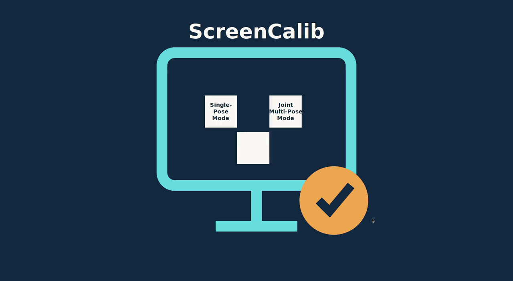

# ScreenCalib

The full source code will be released once the associated paper is published or this repository receives strong community interest.

Use a display to quickly calibrate LiDAR–camera extrinsics.



[Watch the full ScreenCalib software demo](https://www.youtube.com/watch?v=ckqXlYIHabs)

[Watch the single-pose (SP) mode demo](https://youtu.be/TpmN8ugaYNQ)

## Install and launch

### Ubuntu 18.04 x86_64

Download the GUI archive and checksum into the same directory, then run:

```bash
sha256sum -c ScreenCalib-1.1.0-ubuntu18.04-x86_64.sha256
tar -xzf ScreenCalib-1.1.0-ubuntu18.04-x86_64.tar.gz
cd ScreenCalib-Ubuntu18-x86_64
python3 refresh-launcher.py .
./ScreenCalib.sh
```

Run as your normal user, without `sudo`. To launch by icon, double-click `ScreenCalib.desktop` and select **Allow Launching** if prompted. Keep the extracted folder together in a writable location.

The package includes its matching Linux userspace, Python, ROS, OpenCV, PCL, Ceres, Tk, Pillow, and PRoot. Running it requires no separate ROS, Python packages, Docker, or administrator access. It requires an x86_64 Linux host with a graphical X11 desktop and permission to use `ptrace`. Input files under `/home`, `/media`, and `/mnt` are accessible. Results are saved in the extracted package's `results/` directory.

Check the bundled runtime with:

```bash
./ScreenCalib.sh --check
```

### Windows 11 x64

Download `ScreenCalib-1.1.0-Windows11-x64.zip` and fully extract it into a writable directory. Double-click **ScreenCalib.exe** inside the extracted folder. The offline package includes its runtime and third-party libraries; no project source.

Keep the entire extracted folder together and leave it in the same location after the first launch. To move the application, extract the original ZIP again at the new location. The accompanying `.sha256` and `.validation.json` files document the archive checksum and validation scope. You can calculate the ZIP checksum in PowerShell and compare it with the supplied checksum:

```powershell
Get-FileHash .\ScreenCalib-1.1.0-Windows11-x64.zip -Algorithm SHA256
```

The backend libraries were built with Visual Studio 2022 / MSVC 19.40 and Windows SDK 10.0.22621. `ScreenCalib-Environment-Check.zip` can help you check out what Windows SDK/lib are missing.

</details>

## Prepare the display

Available target images (choose one):

- [apriltag_black.png](apriltag_black.png)
- [apriltag_black_rectangle.png](apriltag_black_rectangle.png)
- [apriltag_gray_rectangle.png](apriltag_gray_rectangle.png)
- [apriltag_white_rectangle.png](apriltag_white_rectangle.png)

Before recording your own calibration bag, choose one `apriltag_xx.png` image and show it on the display used as the calibration target.

Use a ruler to measure the actual side length of one AprilTag's black square on the screen, excluding the surrounding white margin. Convert the measurement to meters and enter it as the AprilTag size in the GUI (for example, 35 mm = 0.035 m). Measure with the image at the same display scale used during recording; remeasure if you resize the image or change the display scaling.

## Try the multi-pose example

The [1.1.0 release](https://github.com/ZuhaoZou2026/ScreenCalib/releases/tag/1.1.0) provides native GUI packages for **Ubuntu 18.04 x86_64** and **Windows 11 x64**, including Single-Pose and Joint Multi-Pose modes.

| Download | Contents |
| --- | --- |
| [ScreenCalib-1.1.0-ubuntu18.04-x86_64.tar.gz](https://github.com/ZuhaoZou2026/ScreenCalib/releases/download/1.1.0/ScreenCalib-1.1.0-ubuntu18.04-x86_64.tar.gz) | GUI and bundled runtime |
| [ScreenCalib-1.1.0-ubuntu18.04-x86_64.sha256](https://github.com/ZuhaoZou2026/ScreenCalib/releases/download/1.1.0/ScreenCalib-1.1.0-ubuntu18.04-x86_64.sha256) | SHA-256 checksum for the GUI archive |
| [ScreenCalib-1.1.0-Windows11-x64.zip](https://github.com/ZuhaoZou2026/ScreenCalib/releases/download/1.1.0/ScreenCalib-1.1.0-Windows11-x64.zip) | Windows GUI and bundled runtime |
| [ScreenCalib-1.1.0-Windows11-x64.zip.sha256](https://github.com/ZuhaoZou2026/ScreenCalib/releases/download/1.1.0/ScreenCalib-1.1.0-Windows11-x64.zip.sha256) | Windows archive SHA-256 checksum |
| [ScreenCalib-1.1.0-Windows11-x64.zip.validation.json](https://github.com/ZuhaoZou2026/ScreenCalib/releases/download/1.1.0/ScreenCalib-1.1.0-Windows11-x64.zip.validation.json) | Windows validation scope and results |
| [MP_gui_example_bag.zip](https://github.com/ZuhaoZou2026/ScreenCalib/releases/download/1.1.0/MP_gui_example_bag.zip) | Multi-pose example ROS bag and matching camera-intrinsics YAML |

Extract `MP_gui_example_bag.zip` (tag size = **0.0558 m**). It contains:

- `velodyne64_sx_0p0_sy_m0p0_sz_m0p0.bag`
- `sim_velodyne64_camera_from_bag.yaml`

The ground-truth (GT) extrinsic transform is included in the example bag's `/tf` topic.

1. Open ScreenCalib and choose **Joint Multi-Pose Mode**.
2. Select the extracted bag and camera YAML, and enter the AprilTag black-square size in meters used in the recording.
3. Click **Load bag** and select the camera topic matching the YAML: `/sim/camera/image_raw`. Select the bag's LiDAR topic where prompted.
4. Click **Cut into static poses**. Review the motion plot and detected intervals. Adjust the motion threshold and click **Cut again** if needed.
5. Click **Calibrate** to process the static-pose bags. Use the **Pose N** buttons to inspect individual results.
6. When at least two successful pose bundles are available, click **Joint calibration**. Review convergence and geometry checks before using the final extrinsic transform.

##  Try the single-pose example

Choose **Single-Pose Mode**, load a ROS 1 bag, select camera and LiDAR topics, and click **Check bag**. After validation, click **Next**, enter the AprilTag black-square size in meters, select the camera-intrinsics YAML and output directory, then click **Run calibration**.

| [v1.0.0 release](https://github.com/ZuhaoZou2026/ScreenCalib/releases/tag/v1.0.0) includes the **Single-Pose (SP) mode GUI** and SP_gui_example_bag.zip |
| [SP_gui_example_bag.zip](https://github.com/ZuhaoZou2026/ScreenCalib/releases/download/v1.0.0/SP_gui_example_bag.zip), containing the SP example bag and matching camera-intrinsics YAML. The tag size = **0.0365 m**  |
